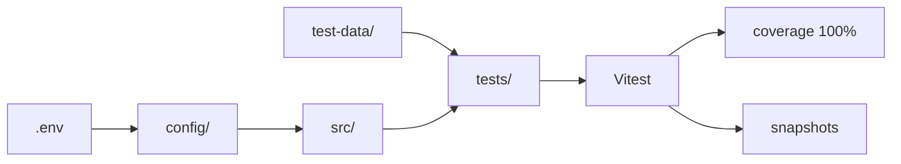

# Architecture

## Diagram



Unit and integration testing practice in TypeScript with Vitest. The repo is
named jest-vitest, but Vitest is the runner: it handles TypeScript and ESM
out of the box with no extra config.

## Folder tree

```text
jest-vitest-js-unit-integration-testing/
├── .env.example          # documented env vars with safe defaults (copy to .env)
├── .gitignore            # node_modules/, coverage/, dist/, .env, *.log
├── ARCHITECTURE.md       # this file
├── README.md
├── package.json          # scripts: test, test:coverage, test:watch, typecheck
├── package-lock.json
├── tsconfig.json         # strict TS, resolveJsonModule (test-data imports)
├── vitest.config.ts      # Vitest config, kept at ROOT (see below)
├── config/
│   ├── environments.ts   # named presets: default, local, ci (base URL + timeouts)
│   └── test.config.ts    # resolved config: env var > preset > default
├── docs/
│   ├── SETUP.md          # install, configure, run
│   └── TESTING.md        # what is tested, how to run, coverage
├── src/
│   ├── api-client.ts     # fetch client: getPost, getPosts, createPost
│   └── utils.ts          # pure helpers: formatPrice, slugify, isValidEmail,
│                         #   calculateDiscount, chunkArray
├── test-data/
│   ├── posts.json        # post fixtures, error payloads, status codes
│   │                     # and status texts, error messages, timeout name
│   ├── users.json        # valid users and invalid email list
│   └── expected-values.json  # expected inputs/outputs for utils tests
└── tests/
    ├── api-client.test.ts    # mocked-fetch + one live-network test
    ├── api-client.mock.test.ts   # fully mocked, no live call
    ├── api-client.errors.test.ts # error handling: network, 404, 500,
    │                             # timeout, malformed JSON (mocked fetch)
    └── utils.test.ts         # unit tests for every utils function
```

## Why each folder exists

| Folder | Purpose |
| --- | --- |
| `config/` | All environment-dependent values in one place. `src/` and `tests/` never hard-code a URL or timeout; they import `config/test.config.ts`. |
| `src/` | The code under test only. No test data, no URLs, no config logic beyond importing the base URL. |
| `test-data/` | Fixture data as JSON. Tests load it instead of inlining literals, so a fixture change is a data edit, not a code edit. |
| `tests/` | Test logic only. Each file mirrors one `src/` module. |
| `docs/` | Setup and testing guides, so the README stays short. |

## Why `vitest.config.ts` stays at the root

Vitest auto-discovers its config at the repo root. Moving it into `config/`
would force every script to pass `--config config/vitest.config.ts` for no
benefit, so it stays at the root and `config/` holds the test *settings*
(environments and resolved values) instead.

## Data flow

```text
.env / shell env vars ─┐
                       ▼
config/environments.ts (presets: default / local / ci)
                       ▼
config/test.config.ts  (resolved: env var > preset > default)
                       ├───────────────┐
                       ▼               ▼
              src/api-client.ts   tests/*.test.ts
              (API_BASE_URL)      (testConfig.apiBaseUrl,
                                   testConfig.liveTestTimeoutMs)
test-data/*.json ────────────────► tests/*.test.ts (fixtures, expected values)
src/*.ts ────────────────────────► tests/*.test.ts (code under test)
```

## How config / test-data / src / tests connect

1. `config/environments.ts` defines the presets. `TEST_ENV` picks one
   (`default` if unset or unknown).
2. `config/test.config.ts` applies env-var overrides (`API_BASE_URL`,
   `API_TIMEOUT_MS`, `LIVE_TEST_TIMEOUT_MS`) on top of the preset and
   exports `testConfig` plus `API_BASE_URL`.
3. `src/api-client.ts` imports `API_BASE_URL` and builds every request URL
   from it.
4. `tests/api-client.test.ts` imports `testConfig` to build the expected
   URLs and the live-test timeout, and loads post fixtures from
   `test-data/posts.json`.
5. `tests/utils.test.ts` loads expected values from
   `test-data/expected-values.json` and users/emails from
   `test-data/users.json`.

## How to add a new test

1. Add any new data to `test-data/*.json` first (new file if it is a new
   subject, e.g. `test-data/comments.json`).
2. Add the test to `tests/` (`*.test.ts`), importing the code from
   `../src/...`, config from `../config/test.config`, and data from
   `../test-data/...`. Never hard-code a URL or a fixture literal.
3. Run `npm test` and `npm run typecheck`; for coverage, `npm run test:coverage`.
